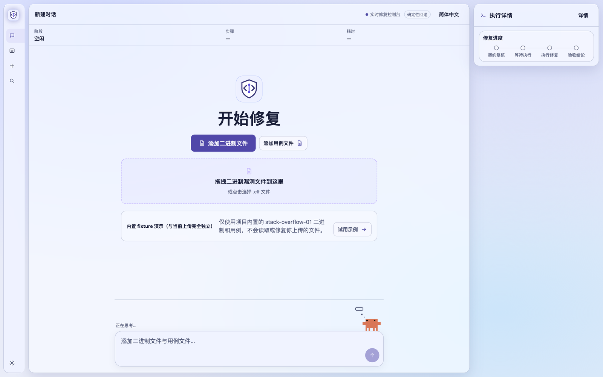
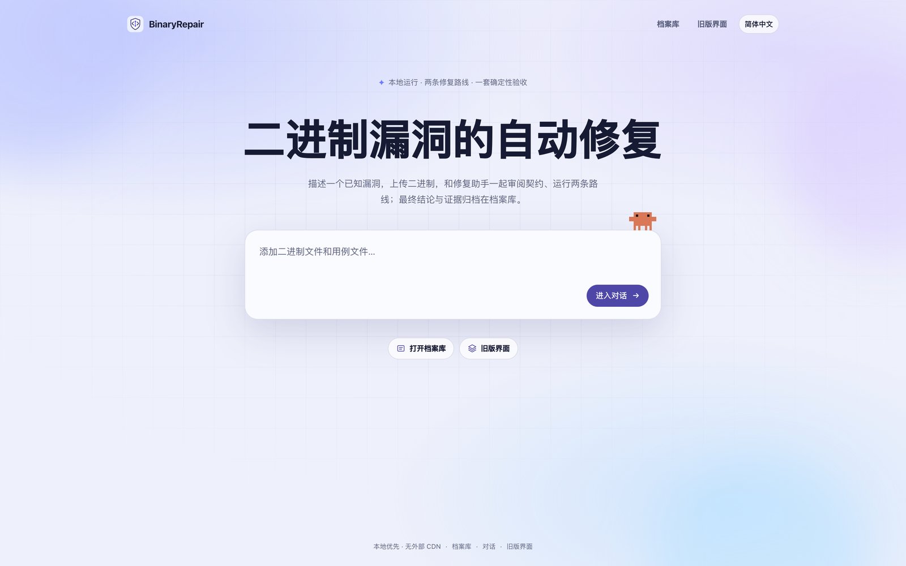
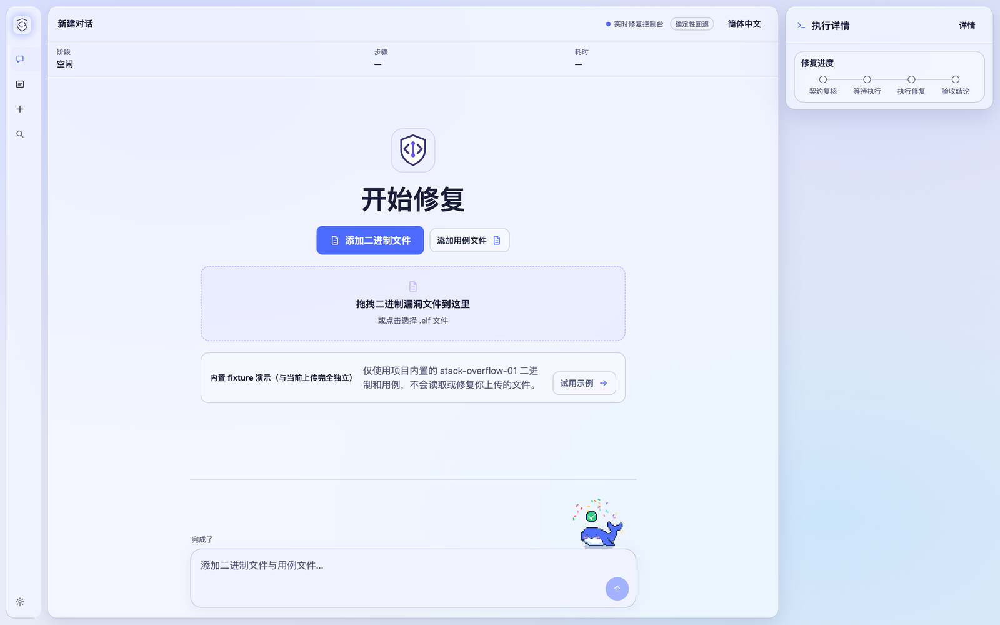
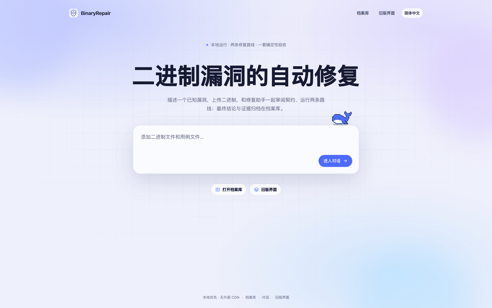

# 桌面像素宠物：Clawd 螃蟹（深色）与 Deepy 鲸鱼（浅色）

本 GUI 的对话页、欢迎页与档案库共用一只交互像素宠物。它不是重新画的仿制品，而是把本机
DSH 插件 `dsh-claude-style` v0.19.6 里**两个品牌版本的吉祥物原样搬过来**，并跟随主题切换：

- **深色主题 → Clawd（Claude 品牌）**：橙色像素螃蟹；
- **浅色主题 → Deepy（DeepSeek 品牌）**：蓝色像素鲸鱼（插件里 DeepSeek 品牌的宠物）。

两个形象的精灵图（螃蟹 38 张 PNG、鲸鱼 18 张矢量 SVG 表图）逐字节取自插件构建产物；帧表
（帧数/裁剪框/reduced-motion 定格帧）、帧间隔（螃蟹 80ms、鲸鱼 50ms）、播放器、优先级状态机、
空闲小动作、睡觉/唤醒、poke/tickle/drag 交互逻辑均按插件源码一比一移植。本 GUI 没有 DSH 的
session 事件，因此只替换「触发条件」：动画集合、时序、优先级与观感不变。

来源与许可：帧图来自 dsh-claude-style（MIT），由 calmly-eating-bugs 绘制；螃蟹形象是 Anthropic 的
Clawd，鲸鱼形象取自 DeepSeek 的蓝鲸标志（见插件 THIRD_PARTY_NOTICES）。迁移时仅改写了宿主定位、
主题选择与信号接入，动画数据未改动。

## 效果（本地 GUI，1600×1000）

| 深色 · 对话页空闲 | 深色 · 思考中 | 深色 · 欢迎页 |
| --- | --- | --- |
|  |  |  |

| 浅色 · 对话页空闲 | 浅色 · 思考中 | 浅色 · 完成庆祝 | 浅色 · 欢迎页 |
| --- | --- | --- | --- |
|  |  |  |  |

刷新 `http://127.0.0.1:8124/ui/chat/`（或欢迎页/档案库）即可看到；静态资源已带新的 `?v=`，
若浏览器仍显示旧版本，按 Cmd+Shift+R 强制刷新一次，无需重启服务。切换深/浅色主题（设置里或
系统主题）时宠物会即时换成对应角色的形象，跑道高度也随之从 84px（螃蟹）变为 112px（鲸鱼）。

## 文件

| 文件 | 作用 |
| --- | --- |
| `app/static/ui/shared/pet.mjs` | 宠物模块：两套帧表、共用播放器/状态机、主题换角色、交互、锚点、`window.BinaryRepairPet` API |
| `app/static/ui/shared/pet.css` | 螃蟹条带 + ink 蒙版机制、鲸鱼矢量表图机制、chat 跑道/分隔线、欢迎页卡片锚点、档案库固定位、最新消息按钮定位 |
| `app/static/ui/assets/mascot/crab/*.png` | 19 组动画的 body/ink 精灵图（插件 PNG 原件） |
| `app/static/ui/assets/mascot/deepy/*.svg` | 18 组动画的矢量表图（插件 0.19.6 的 SVG 原件，brotli 解压后逐字节复制） |
| `app/static/ui/chat/chat-task.mjs` | 对话引擎事件 → 宠物信号（run_state / assistant_delta / thinking / error / awaiting_user / g4_*） |
| `app/static/ui/chat/route-activity.mjs` | 修复运行 journal → 宠物信号（run_state 阶段、plan_update、tool_call、verification、run_end） |
| `app/static/ui/workbench/workbench.mjs` | 档案库任务列表 → `globalThis.__binaryRepairArchiveJobs`（档案页 working 层级） |

## 位置（与参考图一致）

- 对话页：`.composer-wrap` 内、输入卡片正上方 `.pet-runway`（顶部 1px 分隔线；深色高 84px，
  浅色高 112px 以容纳更高的鲸鱼）。宠物站在输入卡片上沿、靠右端，左侧显示当前活动文字；
  跑道是真实布局空间，生成文本永远不会被宠物遮挡。鲸鱼按插件原始锚点（右缩进 8px、脚在卡片边）。
- 欢迎页：站在首屏输入卡片（`form.composer-card`）上沿右端。
- 档案库：固定在视口右下角，脚踩视口底边。
- 窄屏（≤720px）：跑道 78px（深色）/108px（浅色）；`.chat-main:has(> .composer-wrap > .pet-runway)`
  固定栅格列宽，避免旧布局的横向溢出把宠物挤出屏幕。
- 宠物不随指针移动；拖动只播放 `drag` 动画，松手回到锚点（与插件一致）。
- 暂时出现的「最新消息 ↓」小钮贴在输入卡片上沿（跑道底部）弹出，不再悬在整条跑道上方，
  上下滚动生成栏时不会挡住正文。

## 触发条件映射（本 GUI → 插件动画，两个角色共用）

插件优先级：交互 10 > error 时刻 8 > notification 7 > compacting 6 > attention(happy) 5 >
conducting 4 > working 3（typing/music/building 按并发数） > thinking 2 > idle 1；
循环动画至少停留 1000ms，更高优先级可立即打断；一次性动画播完即让位。

| 本 GUI 信号 | 宠物表现 |
| --- | --- |
| `awaiting_user` / 契约等待审批 | `notification`（举手等你） |
| 失败：`run_state failed/cancelled`、journal `error`、`verification error/unsupported`、档案任务失败 | `error` 时刻（X 眼 + 感叹号，4.8s） |
| 成功：`run_state completed`、`run_end` 成功、`verification` 通过、档案任务完成 | `happy` 时刻（庆祝，5.2s） |
| 证据收集：journal `plan_update` 的 `collect`/`freeze` 在跑（或 run_state `screening`） | `compacting`（扫证据） |
| 两条修复路线同时 in_progress（`.route-lane[data-status="in_progress"]` ≥ 2，或 journal 并发步骤 ≥ 2） | `conducting`（指挥两条路线） |
| `activity: working`（流式回答/工具运行）`busy` 1 / 2 / ≥3 | `typing` / `music` / `building` |
| `activity: thinking`（模型思考、排队等待执行、验证阶段） | `thinking`（气泡里想事情） |
| 空闲 20–40s 随机 | 螃蟹：`idle-look` / `idle-wave`；鲸鱼：`idle-look` / `idle-spout`（`idle-laptop` 只在回答打字时使用，空闲不会拿出笔记本） |
| 空闲 60s | `sleeping`（Zzz） |
| 睡着后指针/键盘活动 | `waking` → 回到当前层级 |
| 点击左半/右半、450ms 内连点 4 次、按住拖动 >4px | `poke-left` / `poke-right` / `tickle` / `drag` |

## 主题与配色

- 深色：沿用 Claude 品牌（橙色强调 #d97757 / #e39a7a）+ Clawd 螃蟹；螃蟹的 ink 蒙版随主题取
  `var(--muted)`（深色为浅灰、浅色为深灰）。
- 浅色：强调色改为 DeepSeek 品牌蓝 **#4d6bfe**（按钮/链接/焦点/路线进行中等全部换成该色系，
  见 `chat/glass.css`、`chat/chat.css`、`welcome/welcome.css`、`workbench/workbench.css`，
  柔色底 #e9edff），并显示 Deepy 鲸鱼。
- 插件里鲸鱼的帧图颜色是烘焙的（主色 #4e6fff、深色 #142660、肚皮 #bee1ff），与深色主题无关，
  浅色主题下与新的品牌蓝协调。

## API

```js
window.BinaryRepairPet = {
  mount(),                       // 幂等；按当前主题选螃蟹/鲸鱼
  signal({activity, busy, awaiting, sweeping, routes, runs, moment}),
  setState('idle'|'waiting'|'thinking'|'running'|'happy'|'error'|'sleeping'), // 兼容旧调用
  setWriting(active),            // 回答打字机期间让宠物保持“打字”动画
  speak(text),                   // 兼容旧调用（跑道文字短暂提示）
  __debug: {snapshot, setSignal, setState, moment, react, freeze, sleepNow, wake, forceExtra, theme, root},
};
```

`snapshot()` 包含 `mascot`（`'crab'` / `'deepy'`）、当前角色的 `sheets` 和
`writer`（是否处于回答打字状态）。旧版 `binaryrepair:pet-state` 事件仍然有效。
`__debug` 仅供测试/联调（`freeze(true)` 可阻止 GUI 信号覆盖注入状态，
`theme('light'|'dark')` 可驱动主题切换）。

**回答打字机**：新到的助手回答不再一次性出现，而是按段落/换行从上到下逐段放出
（约 2–4 秒，`prefers-reduced-motion` 时直接显示全文），同时 UI 调用
`setWriting(true)`：
- 深色主题的 Clawd 播放 `idle-laptop`（拿出笔记本打字）+ 状态文字「正在写回答…」；
- 浅色主题的 Deepy 播放 `typing` 动画；回答结束后释放，宠物回到当前层级
  （若有「完成」moment 则先播放完）。
打字机只在实时事件上触发；恢复历史会话不重播。空闲时螃蟹不会触发 `idle-laptop`，
状态行也不会显示「正在写回答…」；该帧和文字只属于 `setWriting(true)` 的真实打字状态。

## 验证

- 精灵图：螃蟹 38 张 PNG 与插件 v0.19.6 构建产物字节一致；鲸鱼 18 张 SVG 与插件
  `lib/assets/*.svg.br` 解压结果字节一致。
- 像素比对（devicePixelRatio=2，逐帧）：
  - 鲸鱼 18 个 clip × 3 帧 = 54 帧，以插件自己的 Deepy CSS + 同一 SVG + 帧表在独立页面重建
    参考，与 GUI 渲染逐像素一致（0 差异）；
  - 螃蟹 19 个 clip × 3 帧 = 57 帧，与插件 PNG body+ink 表（ink 用主题 `--muted` 合成）逐像素
    一致（0 差异）；深色主题布局/像素相对上一轮无回归。
- 主题切换：浅色 ↔ 深色即时换成鲸鱼/螃蟹，跑道 112/84px，无残留节点、无 JS 错误；
  两套素材/状态互不干扰。
- 交互：左/右戳、4 连击挠痒、拖动（不回退位置）后松手回层级；60s 睡觉、活动唤醒；
  reduced-motion 用帧表 still 帧（0 个 WAAPI 动画）。
- 浅色强调色实测 `#4d6bfe`（`--accent` / `--accent-solid`），深色仍为 Claude 橙。
- 「最新消息」小钮实测贴在输入卡片上沿上方 6px、位于跑道内且不与宠物重叠。
- `pytest` 全量 100% 通过；页面无新增 JS 错误（仅既有的 `/api/assistant/key` 401，表示未配置模型 Key）。
